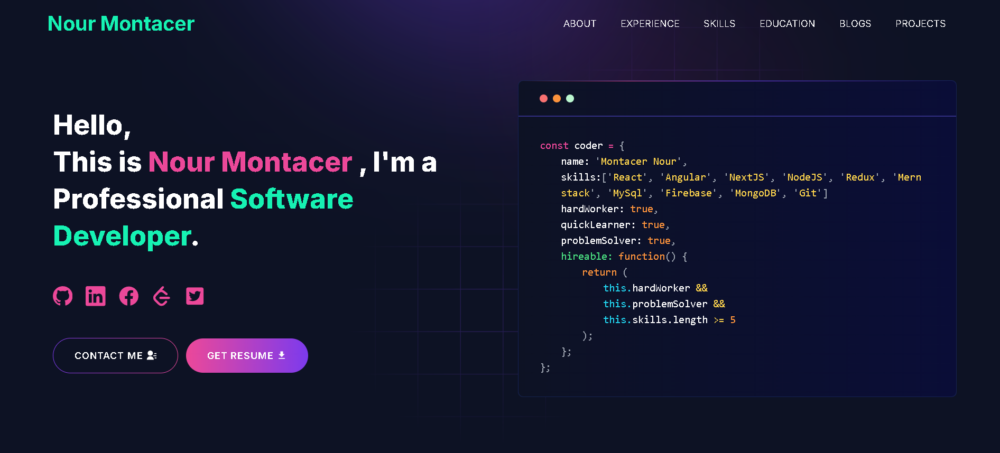

# 👨‍💻 Nour Montacer — Developer Portfolio

[](https://github.com/NourMontacer01/Portfolio/actions/workflows/ci.yml)


My personal portfolio: who I am, my experience, skills, projects, education, latest blog posts
from dev.to and a contact form that sends straight to my inbox.



## 📑 Sections

| Section | Content |
| --- | --- |
| **Hero** | Name, role, social links and résumé download |
| **About** | Short presentation |
| **Experience** | Positions with a Lottie animation |
| **Skills** | Scrolling marquee of technologies |
| **Projects** | Featured projects with stack and links |
| **Education** | Degrees and schools |
| **Blog** | Latest articles fetched from dev.to |
| **Contact** | EmailJS form, optionally protected by reCAPTCHA |

## 🧱 Tech stack

- **Next.js 14** (App Router) and **React 18**
- **Tailwind CSS** + **Sass**
- **EmailJS** for the contact form, **Google reCAPTCHA v2** (optional)
- **lottie-react**, **react-fast-marquee**, **react-icons**, **react-toastify**
- **Google Tag Manager** for analytics (optional)

## 🚀 Run it locally

Requirements: Node.js 18+.

```bash
git clone https://github.com/NourMontacer01/Portfolio.git
cd Portfolio
npm install
cp .env.example .env.local   # then fill in your values
npm run dev
```

Open [http://localhost:3000](http://localhost:3000).

| Command | What it does |
| --- | --- |
| `npm run dev` | Development server |
| `npm run build` | Production build |
| `npm start` | Serve the production build |
| `npm run lint` | ESLint |

## 🔐 Environment variables

See [`.env.example`](.env.example).

| Variable | Required | Notes |
| --- | --- | --- |
| `NEXT_PUBLIC_EMAILJS_SERVICE_ID` / `_TEMPLATE_ID` / `_PUBLIC_KEY` | Yes, for the contact form | From your [EmailJS](https://www.emailjs.com) account |
| `NEXT_PUBLIC_APP_URL` | Yes | Base URL used to call `/api/google` |
| `NEXT_PUBLIC_RECAPTCHA_SITE_KEY` | No | Turns on the captcha when set |
| `RECAPTCHA_SECRET_KEY` | With the site key | **Server-side only** — never prefix it with `NEXT_PUBLIC_` |
| `NEXT_PUBLIC_GTM` | No | Google Tag Manager id |

## ✏️ Customise the content

All the content lives in [`utils/data`](utils/data):
`personal-data.js`, `experience.js`, `skills.js`, `projects-data.js`, `educations.js` and `contactsData.js`.
`devUsername` in `personal-data.js` is the dev.to account the blog section reads from.

## 🙏 Credits

Built on top of the open-source [developer-portfolio](https://github.com/said7388/developer-portfolio) template by Abu Said,
then customised with my own content, fixes and tooling.
